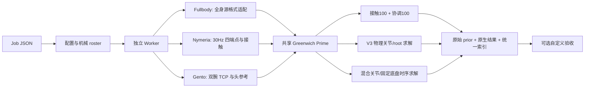

# 架构与调用边界

统一的是组织、配置、生命周期和输出索引，不强行统一不同任务的数学目标。

新增机器人由 roster 和机械元数据提供，不新增某机器人专属 solver。各任务在隔离进程中执行，避免 Gento 历史模块的路径与状态在并发任务中互相覆盖。文件写入先写临时 JSON 再替换；新任务目录禁止复用。

fullbody 直接调用迁入的 Python backend，移除 PowerShell/local-paths 启动依赖。保留 SDK 格式与数值实现。Nymeria 从实际批处理使用的 target-body completion + V3 physical posture 路线迁入，不混入旧 V22 latent 修订。Gento 从 reuse_wrist_alignment 的真实调用迁入，保留公共 0.10m 目标前移与 0.05m 场景后退，报告这些配准量，不伪称原绝对世界位置。

仓库内保留推理源码和小型骨架描述器；权重、私有源语料和人形 vendor 大模型资产由配置指向外部。Gento 已使用的 vendor 几何在 assets 内，路径改为相对路径。数据许可证不会因文件整合而改变。
